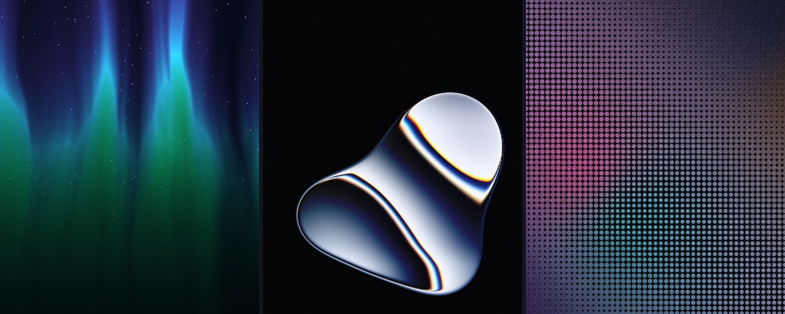
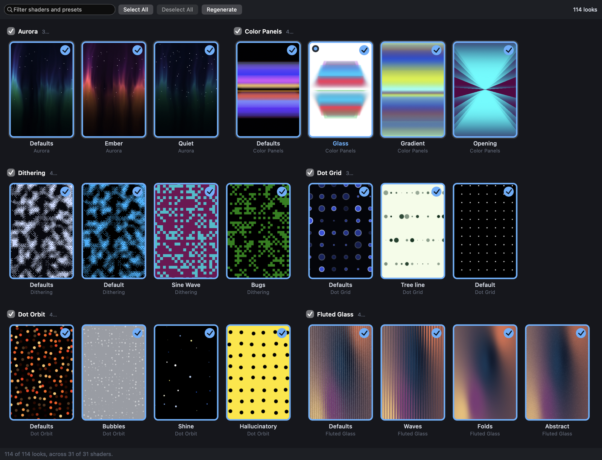
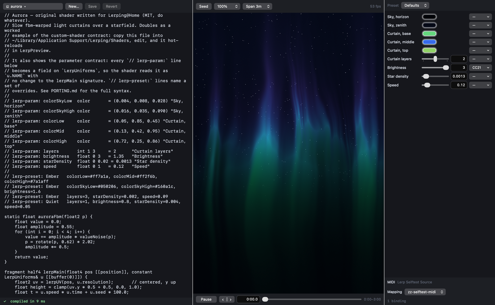

# Lerping@Home



- Screensaver for macOS that renders procedural shaders with Metal.
- Shaders are single `.metal` files compiled at runtime via `MTLDevice.makeLibrary(source:)`.
- 70 built-in shaders in `Sources/Shaders/`: all 30 of Paper Shaders' looks ported to Metal, 28 photoreal Gaussian splat captures (`splat-*`), most with a museum-style caption, raymarched fractals (Mandelbulb, Mandelbox, Menger, Kleinian, quaternion Julia, Sierpinski), 4D slices, GPU simulations (reaction-diffusion, physarum, ink fluid, sandpile, Game of Life), licensed Shadertoy / FragCoord / Vertex Shader Art ports, and originals. `NOTICE.txt` credits each one.
- Custom `.metal` files are supported without rebuilding the engine.
- No Xcode project. Builds with `swiftc` through a Makefile.
- No build-time Metal toolchain and no precompiled shader archive.

## Requirements

- Installation: macOS 14 or later on Apple Silicon.
- Building from source: Xcode command-line tools (`swiftc`).

## Install

Download and open the release DMG, then double-click **Install Lerping@Home**.
The standard macOS Installer opens. The screen saver is required. The Shader
Playground is selected by default, and you can clear its checkbox. Installer
puts the components in these locations:

```text
/Library/Screen Savers/Lerping@Home.saver
/Applications/LerpPlayground.app                 # optional
```

The packaged playground includes the built-in shader sources. It does not need
a source checkout. When you save a built-in shader, the app writes a personal
override to `~/Library/Application Support/Lerping/Shaders`.

To build and install from a checkout, use these commands:

```sh
make saver                 # build, install, verify, and stop stale saver hosts
make playground            # build, install, restart, and open the checkout editor
```

These commands deploy what this Mac runs. Use `make saver-build` or
`make playground-build` for a compile-only build. `make install` and
`make install-playground` are deployment aliases.

### Installer script

`scripts/install.sh` is the fresh-machine path: it checks for macOS 14+ on Apple
Silicon and the Xcode command-line tools, clones the repo when it is not already
in one, and runs `make saver` — then the playground and the auto-updater when you
say yes. Every choice has a flag (`--with-playground`, `--without-auto-update`,
`--repo-dir DIR`), so it also runs non-interactively.

### Automatic updates

The playground checks for updates itself — the Sparkle shape, no background
daemon. On launch and every four hours while it runs, it asks the GitHub
Releases API for the latest release; when the release tag is newer than the
installed saver's `LerpBuild` stamp it downloads the prebuilt saver zip,
verifies the code signature and that the bundle's stamp matches the tag, and
installs it to `~/Library/Screen Savers` — no checkout update, no compiler on
the receiving end. Anything that fails verification is refused and logged.

The menu-bar item (the circular-arrows icon) is the manual side: **Check for
Updates** runs the same script on demand and reports the result, **Automatic
Updates** toggles the background checks, and **Show Update Log** opens the log
at `~/Library/Logs/LerpingAutoUpdate.log`. The toggle is on by default. The
standalone release app has no menu-bar item; its updates come from the DMG. The
installer asks about automatic checks too (`--with-auto-update` /
`--without-auto-update`), defaulting to on.

Releases are cut by hand, on the Mac: `scripts/publish-release.sh [tag]`
builds from a clean checkout, stamps the saver with the tag (default
`vYYYY.MM.DD.HHMM`), signs and notarizes the saver zip and the installer DMG
(see [Build a release image](#build-a-release-image)), and uploads them with the
`gh` CLI. It refuses to run without the Developer ID identities. Run it whenever there
is something worth shipping — until the first release exists, the updater
reports "no releases published yet". The playground itself is never updated
unattended: replacing it could discard unsaved editor state.

### Screen saver



- Select **Lerping@Home** in System Settings → Screen Saver.
- First activation can show black briefly while Gatekeeper verifies the bundle.
- Shader, preset, and render scale are set behind the saver's Options…
  button. Pinning a shader also lets you pin one of its presets.
- Options… also has an **In rotation** gallery: pick which *looks* Shuffle draws
  from, by looking at them. Shuffle rotates over (shader, preset) pairs, not just
  shaders — defaults plus each distinct `// lerp-preset:` look, with a useful
  preset name replacing an identical “Defaults” tile. That is about 266 looks
  across the 76 shaders rather than 76. Every look is a portrait still of itself; click
  a tile to put it in or take it out. They are grouped under a shader heading
  whose checkbox turns the
  whole group on or off and carries an *n/m* count, and there is a search field,
  Select All / Deselect All (which act on what the search is showing), and a
  status line. New shaders and newly added presets join the rotation
  automatically; selecting nothing means all.
- Pointing at a tile plays it, starting at the still's own time rather than
  t=0, so the first live frame matches the still already on screen. One shared
  `LerpMetalView` is reparented into the hovered tile; there is no per-tile
  renderer. Installing it is debounced, so sweeping across the grid compiles one
  pipeline. Scrolling, leaving the tile, and the window losing key each stop it.
  Resuming at the still's time is possible because a frame is a pure function of
  (shader source, parameters, time, seed) — the same property the on-disk still
  cache rests on. See `Sources/LerpCore/RotationPreview.swift`.
- The stills are rendered into the bundle by `make saver`, so opening Options…
  does no GPU work: the sheet is built in about 120 ms and the pictures are on
  screen a tenth of a second later. That matters because the sheet is built
  inside `legacyScreenSaver`, which is App Sandboxed — see "What the sandbox
  allows" below. Anything the bundle does not have a still for (a custom shader,
  a shader edited since the build) is rendered on the spot, in parallel, into a
  cache inside the sandbox container. Nothing ever blocks the sheet.
- The same Library of shader cards is the playground's selector (the toolbar's
  shader button), where the badge writes the screensaver's rotation
  immediately and a click opens the shader in the editor. Per-preset choices
  are made in the playground's inspector. It is one implementation, in
  `Sources/LerpCore/RotationGallery.swift`. See "Shader playground".
- Options… has a **Set desktop picture to the last frame** checkbox, off by default.
  See "Desktop picture handoff" below.

### Playground

Optional, and only for the shader editor described under "Shader playground"
below — the saver does not need it.

The following details apply to a playground built from a source checkout:

- `make install-playground` copies `build/LerpPlayground.staging.app` to
  `~/Applications/LerpPlayground.app`, signs it again and registers it, so typing
  "lerp" into Spotlight offers it. `/Applications`, `/System/Applications` and
  `~/Applications` are the only places Spotlight's Applications category draws
  from; the bundle in `build/` is indexed and `open -a` finds it, but Spotlight
  will not offer it.
- A copy, not a symlink. Spotlight resolves symlinks and indexes the app at its
  real path, so a link in `~/Applications` leaves it exactly as unfindable.
- The installed copy edits the checkout it was installed from, recorded as
  `LerpRepoRoot` in its own `Info.plist` — it cannot walk up to one the way the
  in-repo build does, because nothing above `~/Applications` is a checkout.
  Re-run the target to re-point it.
- That path is the **main working tree**, not `$PWD`: installing from a git
  worktree records the checkout the worktree belongs to, because the worktree
  itself is deleted when its branch is done and an app pointed at it would break
  the moment it was. Override it, or install from outside a git repo, with:

```sh
make install-playground PLAYGROUND_REPO=/path/to/lerping-at-home
```

- Either way the target checks before it copies anything: a `PLAYGROUND_REPO`
  with no `Sources/Shaders` in it stops the install and says so, rather than
  baking in a path that does not work.

- If that checkout later moves, the app says so at launch — by name, with the
  path that is gone — and offers a folder picker. It never opens onto an empty
  shader list. What you pick is remembered;
  `defaults delete com.hergenroeder.lerping.playground.installed LerpRepoRoot`
  forgets it, and `LERP_REPO_ROOT=/some/checkout` overrides it for one launch.
- `LerpPlayground --shaders` prints which checkout a copy resolved, how it got
  there, and what it found, and exits non-zero if it found nothing.
  `make install-playground` runs it against the copy it just installed, so the
  target fails if the install cannot see your shaders.
- `build/LerpPlayground.staging.app` is staging only and is never registered or opened
  by a normal target. `make playground` always runs the canonical copy in
  `~/Applications`.
- Deployment asks the running canonical app to quit through its normal Save /
  Discard / Cancel path and waits for a real exit before replacing it. Cancel
  aborts deployment. A pre-migration build is refused until it is closed once,
  because it cannot prove that unsaved editor text is protected.
- `make uninstall-playground` removes the canonical copy. `make clean` removes
  staging only.

### Build a release image

`make dmg RELEASE_VERSION=0.1.0` creates an unsigned DMG for local inspection.
It does not install either component. The DMG contains the component installer,
which keeps the optional Playground checkbox. The output is
`build/release/LerpingAtHome-0.1.0-arm64.dmg`.

`make package RELEASE_VERSION=0.1.0` builds only the inner PKG when you need to
inspect Installer choices.

A public DMG needs Developer ID Application and Developer ID Installer
certificates, plus a `notarytool` keychain profile. Build and notarize it with:

```sh
make release RELEASE_VERSION=0.1.0 \
  APP_SIGN_IDENTITY="Developer ID Application: YOUR NAME (TEAMID)" \
  INSTALLER_SIGN_IDENTITY="Developer ID Installer: YOUR NAME (TEAMID)" \
  NOTARY_PROFILE=lerping
```

The target signs both bundles and the inner PKG, notarizes and staples the PKG,
then signs, notarizes, staples, and checks the final DMG. It writes a SHA-256
file beside the DMG. `scripts/publish-release.sh` runs it for you, finding the
identities in the keychain, and publishes the result.

One-time setup:

- Only the team's Account Holder can create Developer ID certificates; the App
  Store Connect API refuses. In Xcode, open Settings → Accounts → Manage
  Certificates, click +, and add both **Developer ID Application** and
  **Developer ID Installer**.
- Store the notary profile from an App Store Connect API key; no Apple ID
  password is needed:
  `xcrun notarytool store-credentials lerping --key AuthKey_X.p8 --key-id X --issuer ISSUER`.

## Live shader development

```sh
make preview && ./build/LerpPreview
```

- `←` / `→` — switch shader.
- `space` — pause.
- `r` — recompile current shader.
- `q` — quit.
- `./build/LerpPreview --list` — print discovered shaders.
- `./build/LerpPreview --snapshot out/` — render every shader to PNG.
  - Flags: `--size WxH`, `--time T`, `--seed S`, `--shader name`.
  - Exits non-zero if a shader does not compile.

### GPU cost and profiling

- `./build/LerpPreview --bench` prints a Markdown table of GPU time per frame
  (mean, p95, max, share of a 60 fps budget) for every shader, offscreen, at
  3840×2160. Flags: `--size WxH`, `--frames N` (default 120), `--shader name`,
  `--looks` (every preset, not only each shader's defaults).
- The screensaver, playground and preview log what each look cost while it was
  on screen, as one line per look switch (never per frame):

  ```sh
  /usr/bin/log show --last 1d --style compact \
    --predicate 'subsystem == "com.hergenroeder.lerping" AND category == "gpu"'
  # e.g. gpu voronoi/Molten frames=17940 mean=1.912ms p95=2.301ms max=6.004ms at 3456x2234 over 300.0s
  ```

  Both numbers count GPU busy time from `gpuStartTime`/`gpuEndTime`, minus any
  overlap with the previous command buffer. Queued buffers overlap, so their
  raw spans overstate a slow look several-fold.
- Signposts: `compile` intervals (one per pipeline build, category
  `performance`) and `encode` intervals (one per frame, `.dynamicTracing`,
  recorded only while Instruments is recording). Use the os_signpost or Points
  of Interest instrument, or `/usr/bin/log show --signpost` for `compile`.
- `.gputrace` capture: `./build/LerpPreview --snapshot out/ --shader aurora
  --gputrace aurora.gputrace` captures every frame the snapshot draws. Set
  `LERP_GPUTRACE=path.gputrace` to capture the live window's first
  `LERP_GPUTRACE_FRAMES` frames (default 3). Open the trace in Xcode. The flag
  sets `MTL_CAPTURE_ENABLED=1` itself, so no Xcode scheme is needed.
- Metal Performance HUD in the live window: `MTL_HUD_ENABLED=1
  ./build/LerpPreview` overlays frame rate, frame time, GPU time and memory.
  Add `MTL_HUD_LOG_SHADER_ENABLED=1` to also report shader compilation, which
  is useful while pressing `r` to recompile. Metal reads both variables at
  launch. They only affect a window that presents, so `--snapshot` and
  `--bench` ignore them.

## Shader playground

```sh
make playground
```



- Builds a staging bundle, deploys it to `~/Applications/LerpPlayground.app`,
  gracefully replaces any running older copy, and opens that canonical app.
  The installed bundle has a Dock tile, a ⌘-Tab entry and an app menu, and
  `open -a LerpPlayground` resolves to it.
- **One installed app, one process.** Running `make playground`, `open -a`, or
  using the Dock raises the canonical copy instead of launching staging.
- Closing the window quits the app; unsaved edits get Save / Discard / Cancel.
- The installed app edits the checkout recorded during deployment, so `open`'s
  working directory does not matter. See "Install" above.
- Split window: `.metal` source on the left, live render on the right.
- **What it opens on.** The look you last had open, if it is still on disk and
  still compiles — closing the window mid-shader and coming back to a different
  one loses your place, and nothing is worth that. Failing that (a first launch,
  a deleted shader, one that no longer builds) it draws a look at random from the
  looks your *screensaver* shuffles through, preset and all, so it opens on
  something you actually chose rather than on whatever sorts first. It reads that
  rotation and never writes it; the last-opened look is remembered in the app's
  own preferences, not the screensaver's.
  - The rotation is taken literally, an empty one included; what stops the
    playground opening onto nothing is its own fallback to the first look on
    disk, not a widening of the rotation. A look that will not compile is
    stepped past rather than opened.
- Uses the same LerpCore compile path as the screensaver.
- Editing recompiles 300 ms after the last keystroke and swaps the pipeline in place.
- On a compile error the last successful pipeline keeps rendering; the view does not blank and the process does not exit.
- Under the editor, a pill says whether the buffer compiles: green with the compile time, or red with the error count. Compile errors open as rows above it, one per diagnostic with its line number; clicking a row jumps to that line, and `⌘E` (or clicking the red pill) jumps to the first. Other messages — a Learned CC, a save, an input switched on — appear beside the pill and fade, so they never hide the compile state.
- Metal's reported line numbers match the shader file, because the prelude ends with `#line 1`.
- Navigation is three controls, each with one job:
  - **The selector** — the toolbar button, `⌘O`, or **Shader → Open Shader…** —
    is a popover Library of one card per shader, over `Sources/Shaders/` plus
    the custom shader directory, refreshed when files change on disk. Cards sit
    on shelves — Scenes, Splats, Fractals, Simulations, Abstract, Gradients,
    Patterns — each shader naming its own with `// lerp-category: Fractals`;
    one that names none (yours, until you add the line) goes on Other, with
    the "+" card. ‹ › walk the shelves in the same order. A click
    opens the shader at its cover (the preset its picture shows). The badge in
    the corner is the one place anything goes in or out of the screensaver: on
    a shader with one preset it switches it; on one with several it opens a
    menu — **In Screensaver** for the whole shader (keeping per-preset picks),
    then a check per preset. **All** / **None** in the header switch every
    shader shown. A shader that is out of the rotation is drawn dimmed and
    opens on the same click. A hand-picked shader's caption says "4 of 11
    presets" in amber.
  - **`‹` `›`** beside the button step to the previous or next shader, in the
    selector's order, wrapping at both ends — `⇧⌘[` / `⇧⌘]`, **Shader → Next
    Shader** / **Previous Shader**.
  - **The inspector's Presets list** picks one of the open shader's presets
    (click its name) and saves the values on screen as a new one (**+**, the
    same as `⇧⌘S`). `⌥⌘[` / `⌥⌘]` step through it. Defaults is left out when a
    named preset draws the same picture, as the rotation leaves it out.
  - The selector opens with the caret in a filter field. Typing matches shader
    names *and* preset names; a card found by a preset says which (`▸ Molten`)
    and opens wearing it. ⏎ opens the first card still showing.
  - The grid leads with a dashed **+** card, "New Shader…" — the same scaffold
    `⌘N` runs. It is not a shader: it is in no count, no rotation and no
    filter, and `‹` `›` step straight past it.
  - Pointing at a card plays it. The card for the shader the editor has open is
    marked.
  - The last thing playing cannot be switched off.
- **Shortcuts and Spotlight** get three LerpPlayground actions: **Add Preset to
  Rotation**, **Remove Preset from Rotation** and **List Presets** (all, in the
  rotation, or switched off). A *Preset* is a shader plus one of its presets, or
  its Defaults. The actions run inside the playground, launching it if needed,
  and write through the same path a gallery click does, so the playground is
  still the rotation's only writer; open grids update straight away. Removing
  the last look is refused, as it is in the gallery. There is no pin action:
  the pin belongs to the saver's Options… sheet. The actions need the full
  Xcode to build, because `appintentsmetadataprocessor` ships with Xcode and
  not with the command line tools. Without it the app builds the same, minus
  the actions. See `Sources/Playground/RotationIntents.swift`.
- **Save** (`⌘S`) overwrites the look that is open, and never asks anything. The
  window changes two things — the text and the values — and both live in the same
  `.metal` file, so one command writes both: with a preset on, the values go back
  into that preset's own `// lerp-preset:` block; with none on, into the
  `// lerp-param:` lines' `= DEFAULT`, which is where the Defaults look keeps its
  values. Naming a look that does not exist yet is Save As, and Save As is `⇧⌘S`.
  - Only the `= DEFAULT` token of a declaration moves. The name, type, range,
    label and the column the label sits in are left exactly as they were typed.
  - Saving the defaults moves every preset that stays silent about that
    parameter, because a preset records only what differs from them. That is what
    editing the declaration by hand does too, and it is the only thing saving the
    Defaults look can honestly mean; the status line says how many lines moved,
    and `⌘Z` takes the buffer back.
  - A buffer that does not compile still saves its text. An editor that refuses
    your typing because the shader is mid-edit is an editor with a bug in it —
    it is the *values* that wait for a compile, and the console says why.
  - Save and Revert appear only when there is something to save — a moved
    slider counts as much as a keystroke — and Revert puts both halves back.
  - Closing and quitting do not ask about unsaved changes unless **File → Ask
    to Save Before Closing** is ticked (off by default); off, they are let go.
    Switching to another shader with unsaved *text* still asks.
- **Shader → Save as Preset…** (`⇧⌘S`, or **+** in the Presets list) writes the
  values on screen back into the shader as a named `// lerp-preset:` block. A
  new name adds a preset; entering an existing name replaces it after
  confirmation. The preset joins the Presets list and the screensaver's
  rotation straight away, and the editor ends up wearing it.
  - Only parameters that differ from the shader's declared defaults are written,
    because a preset is an overlay and a line restating a default freezes today's
    value into a file whose author may move it tomorrow.
  - New blocks are appended after the file's existing presets. Replacements stay
    in their existing position, so the saved rotation keeps the same entry and
    enabled/disabled choice.
  - Values are spelled so that re-parsing the file yields the same uniform block
    the GPU was being handed: hex for colours that sit on an 8-bit step, and
    otherwise the shortest decimal that survives a `float` round trip. Dragging a
    slider and saving gives back the picture you were looking at, not one six
    significant digits away from it.
  - It saves the file, unsaved edits included, and says so in the prompt before
    it does: a preset can only name parameters the file itself declares, so the
    block and the edits that justify it are one change. A buffer that does not
    compile is refused — what is on screen then is the last version that did.
  - Preset names are matched without regard to case. Empty names, names with a
    double quote or tab, and `Defaults` are still refused, because `Defaults` is what every
    shader's un-preset look is already called.
- An externally modified open file reloads if there are no unsaved edits.
- Under the render, one strip: a round play / pause button (the only control over time) and the frame rate on the left; on the right a **Resolution** button that opens a menu of Low / Med / High — just an icon at High, with the choice beside it otherwise (a quarter, half or all of the pixels, to trade sharpness for frame rate on an expensive shader), an **HDR** pill at the saver's own peak, and full screen. While system audio, head tracking, hands or a MIDI device is live, a violet chip for it sits beside the frame rate — audio with its levels, MIDI flashing on each message; click one to switch that input off (MIDI's opens its banks). Full screen shows the look's name and preset for a moment on entry and whenever the mouse moves. They map onto `LerpUniforms` and `LerpMetalView.Config`.
- **Randomize** on the inspector's Parameters heading moves every held parameter to a random value in its declared range; drifting parameters keep drifting.
- Editor is a plain `NSTextView` with soft tabs, auto-indent, undo, and find. No syntax highlighting and no line-number gutter.

Keys:

- `⌘O` — open the selector; type to filter, ⏎ opens the first match.
- `⌘N` — scaffold a new starter shader into `Sources/Shaders/`, as the picker's
  **+** card does.
- `⌘S` — save the `.metal` file: the text, and the look on screen back into the
  preset (or the declared defaults) it came from.
- `⇧⌘S` — Save As: the look on screen under a name, as a new preset or over an
  existing one.
- `⌘R` — recompile.
- `⌘\` — play/pause.
- `⇧⌘R` — randomize parameters.
- `⇧⌘[` / `⇧⌘]` — previous/next shader.
- `⌥⌘[` / `⌥⌘]` — previous/next preset of the open shader.

MIDI stays out of sight until you use it. Right-click any parameter and pick
**Learn…**, then turn a knob; the row then shows the CC it is bound to, and that
tag (or another right-click) holds Clear, the knob's mode and its range. Banks of
bindings — new, rename, delete, and `⌥⌘M` for the next one — are in
**Shader › MIDI**, which also says what is connected. A bank made for a device
is picked automatically when that device is plugged in.

Hand control (**Shader › MIDI › Control with Hands**, off at every launch) makes your
hands a MIDI controller, so no device is needed. Hold up an open hand, then
pinch to grab; values move only while you pinch, and letting go leaves them
where they are. Move the pinch for **Hand X** and **Hand Y**, or turn it like a
knob for **Hand Twist** (half a turn sweeps a parameter end to end). A stroke
is one or the other, judged by whether the pinch point travels, so twisting
never nudges the Y-bound parameter. Pinch with both hands and the distance
between them is **Hand Spread**, and turning the pair like a wheel is Hand
Twist. The axes bind like knobs: right-click a parameter, Learn…, then pinch and
move or turn. They are relative CCs 102–105 on channel 16, so they share
banks, ranges and saving with real knobs.

**Drag to turn.** On a 3D look, click and drag on the render — in the pane or
full screen — and the scene turns under the pointer like a globe under a hand:
what you grab moves with you, and the pointer becomes a closed hand once the
press has moved a few points (a click is still a click). Objects in space swing
round their centre; fly-throughs, landscapes and the maze turn the view where
the camera stands. It is not a separate control: the drag moves the look's
**Turn** and **Tilt** parameters (`yaw`, `pitch`), so the sliders follow it,
Save or **+** keeps a framing as a preset that the screensaver then plays, and
a knob or a hand can be bound to it with Learn…. Turn wraps all the way round;
Tilt stops where the look says it should — a splat capture only a little way,
because a capture only holds up near where it was photographed.

**Pinch to zoom.** On the same looks, pinch on a trackpad, or scroll with two
fingers or a mouse wheel over the render, and the scene comes nearer or goes
back. Fingers apart is nearer, at the pinch's own rate — spread to twice the
span and the subject is drawn twice the size. Scrolling reads the way it does
in a web 3D viewer, so it follows your Natural Scrolling setting: content up is
nearer, about a stop for a long trackpad swipe or ten wheel lines, and a
trackpad's momentum carries on after the fingers lift. An object comes nearer
the way a camera walks up to it, so its perspective deepens; a landscape, a
corridor or the maze lengthens the lens instead, since walking would put you
in a wall. It moves the look's **Zoom** parameter (`magnify`, in stops), which
stops where the look says — before the camera is inside the fractal, or past
the edge of a capture. Looks that turn and zoom: the raymarched fractals
(mandelbulb, mandelbox, menger-sponge, quaternion-julia, kleinian,
sierpinski-pyramid, topologica, castle-to-castle), dusk-terrain, sea-and-moon,
star-nest, maze, pipes, polytope-4d and every `splat-*` capture.

The tracking is coding cube's MediaPipe hand control, run in a transparent web
view over the render. The overlay follows The Poet Engineer's hand interfaces:
the hand's skeleton in thin white line (never the camera picture), a dial round
the pinch that turns with it, a meter of the value it is moving, and a legend
of what each bound axis drives. It fades out when your hand leaves. A window
that is completely covered gets no camera frames, so tracking pauses until it
is visible again. Frames stay inside the app. `make` downloads MediaPipe's web
runtime and hand model once, checks them against pinned sha256s and bundles
them; they are not in git.

Other targets:

- `make package RELEASE_VERSION=…` — build the inner Installer package for inspection.
- `make dmg RELEASE_VERSION=…` — wrap that installer in the unsigned release DMG.
- `make release RELEASE_VERSION=…` — sign, notarize, staple, and check the public DMG.
- `make playground-build` — compile-only staging at
  `build/LerpPlayground.staging.app`; it is not registered or launched.
- `make saver-build` — compile-only staging at `build/Lerping@Home.saver`.
- `make install-playground` deploys the canonical Spotlight copy without opening
  it; `make uninstall-playground` gracefully stops and removes it.
- `build/LerpPlayground.staging.app/Contents/MacOS/LerpPlayground --shaders` — print the checkout this copy reads, how it resolved it, and the shaders in it. Exits non-zero if there are none.
- `build/LerpPlayground.staging.app/Contents/MacOS/LerpPlayground --capture out.png` — build the real window the way a launch does, say what it opened on and whether that came from the memory or from a draw against your rotation, and write a PNG of it. Reads your screensaver settings, writes none of them, and puts the last-opened memory back as it found it. The render pane is empty in the PNG: it is a `CAMetalLayer`, which `cacheDisplay` cannot reach.

## Custom shaders

- Custom shader directory: `~/Library/Application Support/Lerping/Shaders/`.
- `LerpPreview` reads that directory at runtime; edit a file and press `r` to recompile.
- The installed screen saver reads this directory at runtime. A custom shader can replace a built-in shader with the same filename stem.
- The packaged playground saves built-in edits here because it cannot modify its signed app bundle.
- `make saver` also copies this directory into a locally built `.saver`. This gives every custom look a bundled gallery still and stops stale saver hosts.
- `make install-example` copies the plasma template into the custom shader directory.

```sh
cp myshader.metal ~/Library/Application\ Support/Lerping/Shaders/
./build/LerpPreview          # iterate without reinstalling
make saver                   # build, deploy, and retire stale saver hosts
```

### Shader contract

- One fragment function per file, with this exact signature:

```metal
fragment half4 lerpMain(float4 pos [[position]], constant LerpUniforms& u [[buffer(0)]]) {
    float2 uv = lerpUV(pos, u.resolution);   // [-1,1] short axis, y up
    float3 color = float3(0.5 + 0.5 * sin(u.time + uv.xyx));
    return half4(half3(color), 1.0h);
}
```

- Uniforms: `u.resolution` (pixels), `u.time` (seconds), `u.seed` (random per launch, `[0,1)`).
- Prelude helpers: `lerpUV`, `lerpScreenUV`, `rotate`, `hash11/21/22`, `valueNoise`, `snoise` (simplex), `glmod/2/3`, `lerpDither`, `PI`, `TWO_PI`.
- The prelude is prepended to every shader before compilation. Source: `Sources/LerpCore/Prelude.swift`.
- Prelude symbols must not be redefined in a shader file.
- Worked example with comments: `Templates/plasma.metal`.
- Porting reference: `PORTING.md`.

### Shader parameters and presets

Tunable values are declared in the `.metal` file itself, so a shader carries
its parameters and presets wherever the file goes.

```metal
// lerp-param: distortion float 0 1 = 0.8 "Distortion"
// lerp-param: octaves    int 1 8   = 4   "Octaves"
// lerp-param: mirrored   bool      = false
// lerp-param: colorBack  color     = #06111C "Background"
//
// lerp-preset: Lagoon     distortion=0.8, colorBack=#06111C
// lerp-preset: "Deep Sea" distortion=0.2, octaves=6
```

- Syntax: `// lerp-param: NAME TYPE [MIN MAX] = DEFAULT ["Label"]`. Types are
  `float`, `int`, `bool`, `color`; MIN/MAX are required for `float`/`int` only.
  Colour defaults take `#RGB`, `#RRGGBB`, `#RRGGBBAA` or `(r, g, b[, a])`.
- Declared parameters become extra fields on `LerpUniforms`, so the shader
  reads them as `u.distortion`, `u.colorBack` — the `lerpMain` signature and
  the buffer bindings are unchanged, and a shader with no parameters compiles
  and renders exactly as before.
- `// lerp-preset: NAME  key=value, …` names a set of overrides; quote names
  with spaces, and repeat the name on later lines to split a long preset. A
  preset is an *overlay*: anything it does not name keeps the declared default,
  and follows it if the default later changes.
- The playground writes this form for you — **Shader → Save as Preset…**
  turns the values on screen into a new named block in the file. See "Shader
  playground".
- `// lerp-animate: NAME LOW HIGH [period=SECONDS]` makes a `float` or `color`
  parameter drift slowly between two bounds, computed from (time, seed) every
  frame so snapshots and scrubbing still reproduce. A preset that sets the
  parameter pins it; `name=animate(LOW, HIGH, period=S)` re-bounds it. In the
  playground its slider moves on its own, a small waveform toggle shows it is
  drifting, and dragging the slider (or turning a MIDI knob bound to it) takes
  control until the toggle hands it back. Details in `PORTING.md`.
- A malformed declaration is a compile error naming the line.
- 75 of the 70 built-in shaders declare parameters (all but `pipes`). The 30
  Paper Shaders ports mirror the upstream props, with defaults set to this
  project's current look and the upstream looks available as presets.
- Inspect and drive them from the CLI:

```sh
./build/LerpPreview --params swirl                                   # declarations + presets
./build/LerpPreview --snapshot build/x --shader swirl --preset Candy
./build/LerpPreview --snapshot build/x --shader swirl --param twist=0.6
```

- The playground shows controls for all declared parameters. The screen saver
  can select named presets, but it does not store arbitrary control values.
  Use **Shader → Save as Preset…** to make a tuned look available to it.
  Details and porting guidance: `PORTING.md`.

### Shaders with CPU-computed data

- A shader that needs more than the 16-byte uniform block — a table, a segment
  list, an occupancy grid — declares a data provider with a comment on one of
  its first lines: `// lerp-data: pipes`.
- The provider computes that data on the CPU each frame and binds it at
  fragment buffer index 1 and up; index 0 stays `LerpUniforms`.
- It also supplies the MSL struct declarations the shader reads it with, spliced
  into the prelude ahead of `#line 1` so error line numbers still match the file.
- A provider must *derive* its data from `(time, seed)` every frame, never
  accumulate across frames — a rendered frame is a pure function of
  (shader, time, seed, parameters), which is what makes `--snapshot --time T`
  reproducible.
- A provider that also needs the shader's `// lerp-param:` values — `life` is
  sized by `size` and stepped at `speed` — implements the `params` overload of
  `bind`. It defaults to the two-argument form, so providers that ignore
  parameters are unaffected.
- **Iterative simulations** are the one thing that cannot be derived in closed
  form, and `life` is the pattern for them: bound the history instead of
  abandoning purity. Each of its ten cellular-automaton stories has an epoch
  sized to its own arc, so reaching *any* t costs at most that one story. Dense
  full-screen soups use toroidal arrays; canonical patterns use sparse,
  dead-edged boards, letting the R-pentomino complete all 1,103 generations
  cheaply. Its shader interpolates the binary board into a continuous organism
  field with membrane lighting, birth pulses, and death glow; the underlying
  automaton remains exact. The cached board's key is its whole input, so
  stepping it forward lands on the bytes a cold rebuild would produce.
- `heatmap`, `life`, `maze` and `pipes` use one. Every other shader keeps the plain
  `fragment half4 lerpMain(float4, constant LerpUniforms&)` signature.
- Protocol and registry: `Sources/LerpCore/DataProvider.swift`. Worked examples:
  `Sources/LerpCore/PipesData.swift` (derive every frame),
  `Sources/LerpCore/LifeData.swift` (bounded history). Details in `PORTING.md`.

### Gaussian splat captures

- The `splat-*` looks draw real, photographed scenes stored as 3D Gaussian
  splats (3DGS): objects turned like pieces in a museum case (a strawberry, a
  triceratops skull, a carved owl, a grape, a bonsai, a rose, a fruit bowl, a
  jade Buddha, a Nuo mask, vanadinite, two quartzes, a bronze Justice, a tiny
  planet, a castle on its lake, a Torah case, a Coke can, a 6 cm plot of
  forest floor, the asteroid Vesta) and places the camera stands inside (a shrine
  approach, a parish church, a town square, a forest path, a Milan basement
  kitchen, a room of Medinet Habu, the Leake Street graffiti tunnel). Each
  declares
  `// lerp-data: splat:<move>:<capture>`; `<move>` is `orbit` (a turntable, or
  an eased arc) or `dolly` (a dolly zoom). A drag on the render swings the
  camera round what it looks at; a capture seen from inside, like the town
  square, adds `:look` so a drag turns the camera where it stands instead.
- How the camera is set up for its capture is one line, not sliders:

      // lerp-camera: period=120 angle=150 arc=150 distance=4.3 height=2 fov=40

  (`period` is seconds a turn, or there and back for an `arc` under 360;
  also `lookHeight`, `clip`, `bob`, and the dolly's `wideFov`, `longFov`,
  `framing`). The sliders a splat look shows are Speed, Turn, Tilt, Zoom and
  its own styling; Speed 1 plays the `period` as written.
- `SplatData.swift` draws them the way 3DGS viewers do: each splat's 3D
  covariance projected to a screen ellipse, a back-to-front counting sort on
  the CPU every frame, and premultiplied blending of instanced quads into a
  texture the provider owns. That runs in `encodeCompute`, so the engine still
  draws one fullscreen fragment function; the look reads the texture at
  `texture(1)` and composites its own glass, filter or sky over it.
- Deformations (`deform` 1–4: ripple, wall waves, twist, dissolve) displace
  splats in the vertex shader; the twist and dissolve are repeated on the CPU
  so the sort sees the moved splats.
- View-dependent colour (spherical harmonics, bands 1–3) is kept: a compute
  pass evaluates it once per visible splat each frame, from the eye's
  direction turned back into the capture's own frame, before the splats are
  drawn. Stone, fruit skin and glaze catch the light as the camera moves.
  Trogir was published without it, so it has band 0 only.
- The captures are third-party (licences and credits in `NOTICE.txt`) and
  large, so they are not in git. `Sources/Splats/captures.json` lists where
  each comes from and how it is turned upright, centred, cropped and scaled;
  `make splats` (run by `make saver`) downloads each one's SOG files once,
  decodes them (`scripts/splat-convert.py`, checked against PlayCanvas's own
  reader), and writes a compact `.lsplat` to `build/splats`, which the saver
  bundles under `Resources/Splats`. **Every capture is used whole**, as it was
  published: 0.2–8.9M splats, about 0.9 GB for all 25. The converter refuses
  the two settings that once thinned captures silently — a `max_splats` cap
  (which kept the largest splats, so fine detail went first) and a source at
  a coarser level of a streamed level-of-detail scene than level 0 — and
  positions are stored as exact 32-bit floats rather than re-quantized to 16
  bits across the scene. The download cache records each chunk's source URL,
  so changing a capture's sources fetches them again instead of reusing the
  old chunks. Needs network the first time.
- A splat look can carry a caption, the way a museum labels a piece:

      // lerp-caption-title:  Seated Dari (Vairocana)
      // lerp-caption:        Jade, 19th century. China, Qing dynasty (1644–1911)
      // lerp-caption-credit: Crow Museum of Asian Arts

  `SplatCaption.swift` sets them like a gallery wall label (a New York title
  in regular weight, an SF line or two set to balanced lines, the credit in
  tracked small capitals under a hairline; all sized from the drawable's
  height) into a mipmapped coverage
  texture at `texture(2)`, and `LerpSplatView.caption` says where its panel
  sits. The look composites it with `lerpSplatCaption`: one treatment for
  every captioned look, with no per-look setting. The label is there when
  the look comes in and fades after six seconds (`LerpCaptionSchedule`), so
  the look plays textless; in the playground, moving the pointer over the
  picture brings it back for a moment, and Shader › Show Captions keeps it.
  Gallery stills leave it out. A captioned look's splat
  texture is mipmapped so the label can blur what is behind it; an
  uncaptioned one is drawn exactly as before.
- Some captures were published with no licence (`"license": "none"` in
  `captures.json`). They are fetched for this machine's saver, as SuperSplat's
  viewer streams them, and `make package` leaves them and their looks out.
- A capture only holds together near where its photos were taken. Cameras
  that leave that region (the dolly backing away, the town square's arc) set
  `clip` in `// lerp-camera:`, which drops every splat nearer than the subject
  minus `clip`.

#### Your photo as a window

    make photo-window PHOTO=~/Pictures/beach.jpg NAME=beach

turns one photo into a splat look you can lean into. Apple's
[SHARP](https://github.com/apple-aiml-research/ml-sharp) predicts, from the
single image, a 3D Gaussian splat of the scene behind it (on the GPU through
MPS). `splat-convert.py photo` takes that from SHARP's OpenCV
axes (y down, the scene at +z, metres) into the `splat:window:` frame, whole,
and the look stands its camera where the photo was taken, with the photo
covering the screen: a centred viewer sees the photo as it was, and with
Shader › Track Head a moving head looks round the depth in it. One plane
through the scene sits on the glass (`GLASS=median`, the default, or `near`,
`far`, or a distance in metres): it stays put while nearer things swing
against the head and farther ones follow. With nobody tracked — the saver, a
still — the look drifts slowly by itself (`sway`, 0 for the photo exactly as
taken).

- `scripts/photo-window.sh` keeps SHARP in `~/Documents/lerping-tools/ml-sharp`:
  its source at a pinned commit, a Python 3.13 venv, and its 2.8 GB checkpoint,
  checked against a pinned SHA-256. `make photo-window-setup` prepares all of
  that without a photo; `DRY_RUN=1` checks everything and prints each step.
- The splats go to `~/Library/Application Support/Lerping/Splats/photo-NAME.lsplat`
  and the look to `…/Lerping/Shaders/splat-photo-NAME.metal`, beside the other
  custom shaders: the playground picks it up at once, the saver reads both, and
  `make saver` bakes the look into this Mac's installed bundle.
- **Licences.** SHARP's weights are under Apple's research-only model licence
  (`LICENSE_MODEL` in its repo), and the splats are made from your own photo.
  Neither is ever committed, put in `build/splats`, or shipped by `make
  package`; the weights are downloaded onto this Mac only.
- Nothing is thinned: the converter drops only splats whose opacity rounds to 0
  in the file's 8 bits, and keeps SHARP's large far-background splats that the
  captures' haze cull would remove. It reports any splat whose size is past
  the format's range.

### GLSL → Metal mapping

| GLSL | Metal |
|---|---|
| `vec2` / `vec3` / `vec4` | `float2` / `float3` / `float4` |
| `mat2(a,b,c,d)` | `float2x2(float2(a,b), float2(c,d))` |
| `atan(y,x)` | `atan2(y,x)` |
| `inversesqrt` | `rsqrt` |
| `mod` | `glmod` (not `fmod`; results differ for negatives) |
| `gl_FragCoord` | `pos` |

## Layout

```
Sources/LerpCore/     shared engine, no ScreenSaver dependency
  Prelude.swift        Metal prelude prepended to every shader at runtime
  ShaderLibrary.swift  shader discovery (bundle + custom dirs) + runtime compilation
  ShaderParameters.swift  `// lerp-param:` / `// lerp-preset:` parsing, layout and packing
  DataProvider.swift   optional per-frame CPU→GPU data for shaders that need it
  PipesData.swift      data provider for pipes: deterministic lattice walk
  LerpRenderer.swift   fullscreen-triangle pass encoder
  GPUDiagnostics.swift per-look GPU cost meter + signposts
  LerpMetalView.swift  CAMetalLayer view: CADisplayLink, pacing, occlusion pause
  Snapshot.swift       offscreen render to PNG (HEIC for gallery stills)
Sources/Shaders/     built-in shaders, shipped as bundle Resources
Sources/Saver/       ScreenSaverView shim + Info.plist
Sources/Pulse/       LerpPulse, the LaunchAgent that keeps the critter's ledger
Sources/Preview/     LerpPreview dev app / snapshot CLI
Sources/Playground/  LerpPlayground editor + live render, hot reload
  Info.plist           the .app's identity: bundle id, name, icon
Packaging/          Installer choices, copy, and safe-update script
Templates/          example shader
```

`LerpCore` holds the rotation gallery (`RotationGallery.swift`,
`RotationThumbnails.swift`, `RotationPreview.swift`) and the colours and control
helpers it draws with (`UIChrome.swift`) because it has two hosts that cannot
see each other's sources: the screensaver's Options… sheet and the playground's
toolbar selector. What stays in `Sources/Playground/` is the part that is the
playground's alone — `ShaderPicker.swift`, the popover, and
`RotationStore.swift`, which writes the screensaver's ByHost domain the moment
you click. `RotationStore` is
*not* hoisted: it needs `-framework ScreenSaver`, and neither the preview app nor
the snapshot renderer should have to link a framework they never use.

## Runtime behavior

- Frame rate is the panel's refresh rate (120 on ProMotion, 60 on a 60 Hz screen), as macOS's
  own screensavers do — there is no frame-rate setting, because the system offers none. Set via
  `CADisplayLink.preferredFrameRateRange` and animated to each frame's `targetTimestamp` so motion
  steps evenly. A look whose GPU time (p95 over its last ~2 s) overruns 85% of the frame is paced
  down to the next rate that divides the panel's refresh (120 → 60 → 40 → 30) and logged as
  `pace:`; every new look starts back at the panel's rate.
- Frame rate drops to 0 fps when the window is occluded — but only where AppKit actually
  reports occlusion. It does not for a `legacyScreenSaver` host at the desktop-wallpaper
  layer, which is why the saver has a second, independent check; see below.
- No frame-rate caps of our own for battery, Low Power Mode or heat: macOS manages those itself —
  its Low Power Mode throttle reaches every app's display link, and a GPU it slows for heat
  shows up to the pacer as slower frames. The saver holds back EDR on battery and in Low Power
  Mode; the playground does not.
- Internal render scale is selectable at 100%, 75%, or 50%; the compositor upscales.
- The animation clock is frozen while paused, so time does not jump on resume.
- "Still image" (default: after 30 minutes) stops rendering and holds the last frame.

## legacyScreenSaver behavior handled in `Sources/Saver/`

- The system does not destroy saver instances, and never reports occlusion for a host parked at the desktop-wallpaper layer (`CGWindowLevel -2147483625`, full-screen bounds, `onscreen=false`). Neither of `LerpMetalView`'s own stop paths is reachable there, so such a host renders forever behind the desktop. Measured on macOS 27: **5.5% CPU sustained** (`ps -o time=` delta of 1.65 s over a 30 s window) with the screensaver not running.
- **The saver always draws on `startAnimation`.** Gating that on the start notifications produced a permanently black screensaver, twice: legacyScreenSaver spawns the host *after* `willstart`/`didstart` are broadcast, distributed notifications are not queued, and a fresh process therefore cannot ever see the start of its own session. A host only ever observes the stops.
- `stopAnimation` *is* called on macOS 27, ~400 ms after `didstop`. Both `startAnimation` and `stopAnimation` stay wired up; the stop notifications are what usually ends a session first.
- **Nothing about the host tells you which kind it is.** Measured, and each rules out an obvious fix:
  - Both kinds sit at window level `-2147483625`. So does WallpaperAgent's own window.
  - A host that is *visibly rendering the screensaver* has `kCGWindowIsOnscreen` **false** on its own window for the whole session — its layer is composited into a window belonging to WallpaperAgent and its own window is never ordered in. Sampled once a second from outside the process across two real activations, one of them 11 minutes long. `NSWindow.isVisible` and `occlusionState` follow the same window, which is also why occlusion notifications never arrive. Anything keyed on them blacks out the real screensaver.
- So the saver does not classify itself. It draws, and it drops to **one frame a second** only when it can prove nothing it draws can be on screen: every display asleep, the session not on the console, or somebody demonstrably working at the machine for five consecutive seconds (any input at all ends a screensaver, so that cannot be true of the host the user is looking at).
- Against those stands one piece of positive evidence that overrides all of them: `CAMetalDrawable.presentedTime`, i.e. a frame of ours that actually reached a display. Measured with this view's exact shape — 299 non-zero times out of 300 frames in a window that is on screen, 0 out of 300 in one that is not. It is evidence in one direction only; a visible layer that is composited rather than given a display plane can report zero too, so its absence proves nothing and is never read as proof.
- Parking is one frame a second rather than zero on purpose. A host parked by mistake is a slow screensaver for one second, not a black one, and the frame it draws each second is what re-tests the verdict. Measured on a full-screen 1512×982 hidden host: **1.42% CPU rendering → 0.32% parked**, parked 8 s in.
- The host process is never terminated. `exit(0)` on `willstop` raced the lock-screen UI, which is why the lock screen was blank, animated, or static at random. A retained window with its backing store intact costs nothing and makes the lock screen deterministic — it shows the frame the saver stopped on.
- Consequence: after `willstop` the lock screen shows a **frozen** last frame, not animation. `willstop` is the system saying the session is over.
- A host never sees `willstart`/`didstart` for its own session, but a host that outlives one *does* see the next one's. That is what un-parks a host that parked itself in error. Hosts are reused: the same pid was observed serving two sessions, building a new window for each.
- legacyScreenSaver can construct **two** `LerpSaverView` instances per host, the second ~165 ms after the session has already started. Only one of them is ever put in a window; anything with a side effect (the wallpaper handoff) is gated on `window != nil`.
- The System Settings preview instance keeps the classic `startAnimation`/`stopAnimation` contract, ignores the distributed notifications and is never parked, so neither a real screensaver cycle nor a verdict can freeze or slow the thumbnail.
- `isPreview` is unreliable on macOS Tahoe, so a small frame size is also treated as preview.
- `animateOneFrame` is not used; the view drives its own display link.
- Lifecycle is logged to `com.hergenroeder.lerping` at `info` level; nothing about this path is debuggable without it:

```sh
log show --last 5m --info --style compact --predicate 'subsystem == "com.hergenroeder.lerping"'
```

## The critter

`critter` is a look that is alive: a small sprout creature on a toy island that
grows, or wilts, with how this Mac gets used. It hatches from an egg, grows from
baby to child to grown (a flower on its sprout) by a day's worth of good days at
a time, and keeps a record on the island — a flower in the meadow for each good
day of the last two weeks, a new tree every few days of its life. The sky is the
real time of day and the trees the real season.

When the screensaver comes up it notices you first — a double-take, a "!", a
wave — then gets on with how it feels, drawn with its strongest feeling the
most likely: asleep at 3 am, or face-down after an eleven-hour day; pacing
under a storm cloud with a scribble over its head after an hour of
app-hopping; stretching when the screensaver started right after a long run
with no break; sniffling under a rain cloud after a bad week; waving after days
away; building a sandcastle on a day spent making things; hopping and chasing
butterflies when things are good. Its face shows it (eyelids, ^^ eyes, a smile
or a frown, bags under its eyes), and small moments — a yawn, a sneeze, sniffing
a flower — interrupt whatever it is doing. Later 36-second chapters are drawn by
weight, so it does not repeat itself. Its vitals are read once per session, so
nothing about it changes mid-session; the camera stays close and comes round
to its face, and the look takes the playground's drag to turn and pinch to
zoom.

**Where the data comes from.** The saver only runs while nobody is using the
Mac, inside a sandbox that cannot write anywhere shared, so it cannot watch how
the Mac is used. `make saver` also installs **LerpPulse** (`Sources/Pulse/`), a
LaunchAgent (`com.hergenroeder.lerping.pulse`) that once a minute asks how long
since the last input, whether the screen is locked, what kind of app is in
front, whether an app is holding the display awake (a film, a video call) and
whether the microphone is running (a call). It needs no privacy permission. It
keeps per-day totals in
`~/Library/Application Support/Lerping/Critter/ledger.json`: active minutes
(watching counts as screen time, not as a break), minutes after midnight, the
longest run without a 5-minute break, breaks taken after 10+ minutes of use,
switches between *kinds* of app, and minutes per kind (make / chat / browse /
play / other). Moving between two editors, or glancing at another app for under
ten seconds, is not a switch, and launchers, password managers and menu-bar
popovers are not apps in front. App names never reach the file.

`CritterLedger.swift` holds all of it as pure functions — `fold` turns one
sample into the ledger, `CritterVitals` turns the ledger into the critter. A
day's score weighs screen hours, late nights, the longest run (which costs less
than late nights: deep work is not doomscrolling), scatter, and what the hours
went on (making and talking lift a day; long hours of play and browsing drag
it). Growth
adds each finished day — its score in proportion to how much of a day it was,
the rest counted as rest, so an hour of good use never grows less than a day
off. Days older than 120 are pruned into a running `archivedGrowth`, so growth
keeps going for years. A ledger that cannot be read is moved aside as
`ledger.corrupt-<time>.json`, never overwritten.

- `LerpPreview --critter-selftest` checks all of that against a synthetic
  clock (CPU only; it never touches the real ledger).
- `LerpPulse --probe` prints what one sample would see right now.
- `"$HOME/Library/Application Support/Lerping/Pulse/LerpPulse" --report` prints
  the critter's current vitals.
- The look's `mood` parameter shows canned states (thriving, burnt out, night
  owl, scattered, about to hatch, finally a break); `clock` sets the hour and
  `act` pins an activity, for the playground.
- `LerpPreview` always renders a fixed fixture creature, so snapshots and
  gallery stills stay reproducible; `LERP_CRITTER_LIVE=1` (and
  `LERP_CRITTER_LEDGER=path`) make it read a ledger instead.
- `make uninstall-pulse` stops the sampler and keeps the ledger.

## What the sandbox allows

`legacyScreenSaver.appex` — the process that hosts the saver *and* builds its
Options… sheet — carries `com.apple.security.app-sandbox`. Measured on macOS 27,
Apple M5, by ad-hoc signing a host with a transcription of legacyScreenSaver's
own entitlements and loading the real `.saver` into it:

| | |
|---|---|
| `NSHomeDirectory()` | `~/Library/Containers/<id>/Data` — a real container |
| `MTLCreateSystemDefaultDevice()` | yes |
| `device.makeLibrary(source:)` | yes, 1–43 ms for a trivial shader |
| write `<container>/Library/Caches/…` | yes |
| write `~/Library/Caches/…` | **denied** — "You don't have permission to save the file" |
| read `~/Library/Application Support/Lerping/Shaders` | yes — the appex holds a read-only exception for `/` |
| read its own `Contents/Resources/Thumbnails` | yes |
| build the real Options… sheet | 121 ms, 124 tiles (123 built-in + 1 custom) |
| fill it | 0.16 s — 123 stills off the bundle, 1 rendered |
| reopen it | 90 ms, entirely from memory |

So the sandbox can render, but it cannot cache anywhere the rest of the machine
can see — the stills are baked into the bundle by `make saver`
rather than shared with the playground's `~/Library/Caches` copy, and why
whatever the bundle is missing is cached in the container instead. The read-only
exception for `/` is also why a custom shader in
`~/Library/Application Support/Lerping/Shaders` shows up in the sheet's gallery
even before `make saver` bakes it into the bundle.

## Desktop picture handoff

- **Off by default.** Enable with **Set desktop picture to the last frame** in Options….
  Off by default.
- On `com.apple.screensaver.willstop` the saver reads the exact `shaderName`, `time` and
  `seed` the view is on, re-renders that frame offscreen at each display's native pixel
  size via `LerpSnapshot`, writes it to a new PNG, and calls `NSWorkspace.setDesktopImageURL`
  for each `NSScreen`.
- Effect: the desktop, the locked session, and the pre-login login window all show the frame
  the screensaver ended on. macOS propagates it — `wallpaperexportd` mirrors the desktop
  picture to `/var/db/Wallpapers/<uuid>/Wallpaper.png` and to the Preboot volume, which is
  what the pre-login window reads. Verified end to end on macOS 27.
- The export is downscaled to logical points (a 3024x1964 render comes back out as 1512x982),
  so rendering at native panel resolution is already more than enough.
- **Where the file goes:** `legacyScreenSaver` is sandboxed and writing to the real
  `~/Library/Application Support/Lerping/wallpaper/` is denied outright, exactly like the
  custom shader directory. The stills land in the sandbox container instead:

```
~/Library/Containers/com.apple.ScreenSaver.Engine.legacyScreenSaver/Data/
  Library/Application Support/Lerping/wallpaper/<shader>-<id>-<screen>.png
```

  `setDesktopImageURL` accepts that URL and `wallpaperexportd` mirrors it — verified. The
  consequence is that the desktop picture points into a sandbox container: if the container
  is ever reset, the wallpaper breaks until the next screensaver cycle.
- Every frame is written to a **new** filename. Rewriting the same URL does not refresh the
  desktop picture.
- `~/Library/Application Support/com.apple.wallpaper/Store/Index.plist` is never edited
  directly. `WallpaperAgent` holds an in-memory copy and flushes it back over any edit, and
  it lags the API call by seconds, so it is not a way to confirm anything either.
- Generated PNGs older than two minutes are deleted after each successful handoff. Age-based
  rather than "delete everything I did not just write", because with more than one display
  macOS can run more than one saver host and a strict keep-set lets one host delete a still
  another host just handed to the wallpaper agent.
- Multi-display: each `NSScreen` gets its own render at its own aspect ratio. The Preboot
  export is per **user** — one file — so the login window only ever shows the primary
  display's frame. That is a macOS limitation, not something this code can fix.

## Wallpaper mode

- Not implemented; the handoff above is a still image, not a live animated desktop.
- `LerpMetalView` has no ScreenSaver dependency and can be hosted elsewhere.
- Path: a menu-bar app placing one `LerpMetalView` per `NSScreen` in a borderless window at `kCGDesktopWindowLevel`, with `ignoresMouseEvents`, `.canJoinAllSpaces`, `.stationary`, and occlusion pausing.

## License

- AGPL-3.0-or-later. See `LICENSE`.
- Copyleft: derivative works and redistributed modified versions must also be released under AGPL-3.0.
- AGPL-3.0 adds section 13 to GPL-3.0: users interacting with a modified version over a network must be offered its source. This program does no network interaction, so section 13 is inert here.
- Apache-2.0 is one-way compatible with the GPL-3.0 family, so the combined work is conveyed under AGPL-3.0. Apache-2.0 is not compatible with GPL-2.0.
- `Sources/Shaders/aurora.metal` is original work, additionally offered under MIT in its file header.

## Sources

- [paper-design/shaders](https://github.com/paper-design/shaders) — Apache-2.0. 30 of the 68 shaders are ports of it; the prelude's hashes, value noise, simplex noise and banding fix derive from it. Per-shader attribution in `NOTICE.txt`.
- Neuro Noise — original GLSL algorithm by [@zozuar](https://github.com/zozuar), via Paper Shaders.
- Microsoft 3D Pipes (`sspipes`, Copyright (c) 1994-1995 Microsoft Corporation) — `Sources/Shaders/pipes.metal` is an original raymarched SDF sharing no code with it, and reuses its published numeric constants. See `NOTICE.txt`.
- Microsoft 3D Maze (`ssmaze`) — `Sources/Shaders/maze.metal` is an original ray-cast homage sharing no code, textures or artwork with it. See `NOTICE.txt`.
- The OpenGL "teapot" material table (emerald, jade, pearl, ruby, turquoise, brass, bronze, copper, gold, silver, plastics, rubbers) — long-published values used by `pipes`.
- [orchetect/swift-midi](https://github.com/orchetect/swift-midi) — MIT. MIDI I/O for the playground, linked statically via `Sources/MIDIDeps`. Formerly named MIDIKit.
- [MediaPipe](https://github.com/google-ai-edge/mediapipe) — Apache-2.0. Tasks Vision web runtime and hand landmarker model, for the playground's hand control; downloaded and bundled at build time, not in git.
- [MIKMIDI](https://github.com/mixedinkey-opensource/MIKMIDI) — MIT. The MIDI mapping model (per-device bindings, MIDI learn, named banks) follows its design. No MIKMIDI code is used and it is not a dependency.
