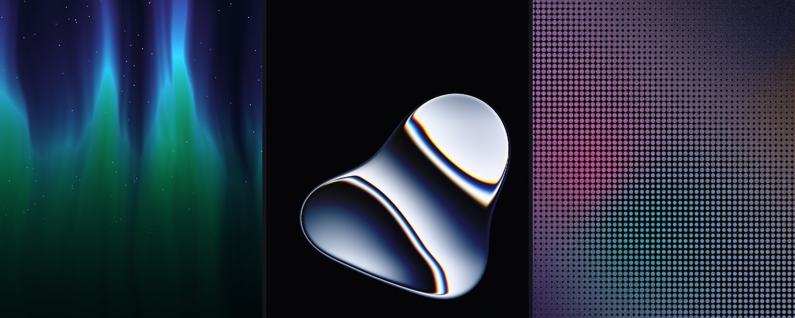
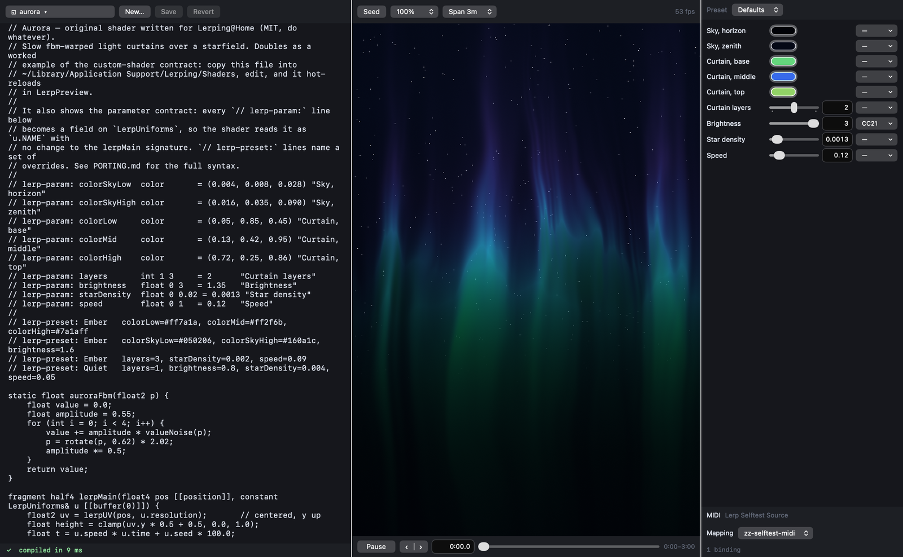

<!-- Launch draft. Confirm feature availability against the signed release before promoting to README.md. -->

# Lerping@Home

**Idle Apple Silicon, alive to your weather, music, and day.**

Come back to a window streaked with the same rain that's falling outside. Put on a record and watch the light pick up its colors and move with the bass. Lean sideways and look past the foreground of a photo you took years ago.

Lerping@Home is a collection of living scenes for your Mac's screen saver, desktop, or full-screen canvas. It's something your screen does when you're not asking it to do anything. Nothing to click, nothing to catch up on.



## Find something you'd leave on

| Shelf | What you'll see |
| --- | --- |
| **Atmosphere** | Rain beads and bends the view through **Weather Window**. Its sky follows local daylight and weather conditions; you can also pick a storm when it's sunny out. |
| **Living Worlds** | Lanterns light up a little village. A critter grows over days, with its mood shaped by the hour and, with LerpPulse running, how you've used this Mac. |
| **Windows** | A museum object you can turn, a place you can look around, or your own photo with depth. Drop a photo into Playground and lean to see the foreground move against the background. |
| **Sound & Flow** | Light, liquid metal, and patterns that respond to music. On compatible looks, the audio drives motion and the album cover supplies color. |
| **Meditative** | Slow, quiet looks for when you don't want the screen to be the most interesting thing in the room. |

Custom looks without a recognized shelf appear under **Other**.

**Screen saver** plays one favorite or shuffles through the looks you choose. **Ambient Frame** fills the display when you want the picture now. **Desktop Mode** plays it behind your icons while Playground is open, without changing your wallpaper. Quit the app and your desktop is as it was. Desktop Mode can hold still in Low Power Mode or when the Mac gets too hot.

## Get it running

Requires macOS 14 or later on Apple Silicon. Live system audio requires macOS 14.2 or later and permission to capture it. Camera-based parallax needs camera permission in Playground.

1. Download the DMG from [GitHub Releases](https://github.com/codyhxyz/lerping-at-home/releases). Open it and double-click **Install Lerping@Home**. The screen saver goes in `/Library/Screen Savers`; the optional Playground goes in `/Applications` and doesn't need a source checkout.
2. Select **Lerping@Home** in **System Settings → Screen Saver**. In **Options…**, choose Shuffle or pin a look and set the render scale. The saver's gallery shows the rotation; change it with the badges on cards in Playground's Library.
3. Open **LerpPlayground**. Press **⌘O** to browse. Use **Shader → Preview Full Screen** (**⌃⌘F**) or **Shader → Desktop Mode** to live with a look beyond the screen saver.

### What makes a scene react?

- **Time and weather.** Local daylight follows the clock. Live conditions use [Open-Meteo](https://open-meteo.com/) for the configured location; it's a weather feed, not a camera pointed outside. You can enjoy fixed presets without the feed.
- **Sound and album art.** **Shader → React to System Audio** listens to what the Mac is playing, not the microphone. The live renderer uses levels and transients, not recorded audio. Album colors are separate: compatible Now Playing sources provide artwork, with [SpotAPI](https://github.com/Aran404/SpotAPI) as an optional, unofficial Spotify source. No Spotify account or connection is needed for sound-reactive motion. The screen saver can use available background signals, but doesn't capture system audio itself.
- **Your day.** LerpPulse is a local helper. The critter's ledger summarizes activity by broad app category; it doesn't store app names. Music metadata and palette, weather, clock, activity, and idle signals are separate from that history. The helper makes them available to the renderers at `~/Library/Application Support/Lerping/world.json`. Missing inputs leave a look playable without them.
- **Your point of view.** **Shader → Track Head with Camera** gives compatible windows parallax. Camera frames are used on this Mac, not recorded or sent. It's a depth effect from one image, not a reconstruction of everything outside the photo.

## Open the hood

Playground is a canvas first. Open **Code** to see the `.metal` source next to the render. Move sliders, save a preset with **⇧⌘S**, or edit the source and watch it recompile. A bad edit leaves the last good render on screen. MIDI learn and hand control are there if you'd rather play a look than type one.



A look can be one file: parameters, presets, drift, and reactive mappings travel with its Metal code. Put custom `.metal` files in `~/Library/Application Support/Lerping/Shaders/`. Saving a bundled shader in the release app writes a personal override there instead of modifying the signed app. See the [plasma template](../../Templates/plasma.metal) and [porting guide](../../PORTING.md) for the `lerpMain` signature, prelude, and data providers.

```metal
// lerp-param: distortion float 0 1 = 0.35 "Distortion"
// lerp-param: colorBack color = #06111C "Background"
// lerp-preset: Lagoon distortion=0.45
// lerp-react: distortion <- audio.bass 0.3..0.65 smooth=0.15
// lerp-react: colorBack <- music.palette0 mix=0.5
```

### From a checkout

Build with Xcode Command Line Tools (`swiftc`) and `make`; no Xcode project, offline Metal compilation step, or precompiled shader archive. Metal source is compiled at runtime. Some assets download on first build.

```sh
make saver                  # installs the local screen saver and LerpPulse
make playground             # installs and opens the canonical checkout Playground
make preview                # builds the developer preview / snapshot CLI
./build/LerpPreview --list
./build/LerpPreview --snapshot build/stills --shader aurora --size 1920x1080
./build/LerpPreview --bench --shader aurora
```

The local installs are under `~/Library/Screen Savers` and `~/Applications`. `make saver-build` and `make playground-build` build only; don't launch the staging app. The checkout Playground reads the main checkout by default; `PLAYGROUND_REPO=/path/to/checkout` can override it at install time. Deployment uses the running app's Save / Discard / Cancel flow; Cancel aborts installation. The checkout app can check releases for a newer signed saver; it doesn't replace the editor unattended. Standalone users update from the DMG. See [scripts/install.sh](../../scripts/install.sh) for fresh-machine setup and [scripts/publish-release.sh](../../scripts/publish-release.sh) for signed release publishing (Developer ID Application and Installer certificates and a `notarytool` profile required).

```sh
# Unsigned local release artifacts; these don't install anything.
make package RELEASE_VERSION=0.1.0  # installer PKG
make dmg RELEASE_VERSION=0.1.0      # DMG containing the PKG

# Source-checkout alternatives for a photo look; use unique names.
make depth-window IMAGE="$HOME/Pictures/beach.jpg" NAME=beach
make photo-window PHOTO="$HOME/Pictures/beach.jpg" NAME=beach-splat
```

The first photo route uses an on-device depth map; the second uses Apple's [SHARP](https://github.com/apple-aiml-research/ml-sharp) for a Gaussian splat. SHARP's research-licensed weights and your photo outputs aren't bundled in releases. Some third-party captures are available for local builds only and excluded from release packages where redistribution isn't licensed.

### How it fits together

- [`Sources/LerpCore`](../../Sources/LerpCore) contains the shared Metal renderer, parameter parsing, data providers, gallery, and deterministic snapshots. [`Sources/Shaders`](../../Sources/Shaders) contains the looks. Normal stills and gallery previews don't depend on live input.
- [`Sources/Saver`](../../Sources/Saver) is hosted by macOS inside `legacyScreenSaver`; it reads the rotation. [`Sources/Playground`](../../Sources/Playground) is the only rotation writer and hosts the editor, live system audio, camera input, and desktop windows. The saver does **not** set the desktop picture.
- [`Sources/Pulse`](../../Sources/Pulse) supplies background context. [`Sources/Preview`](../../Sources/Preview) provides the test and render CLI. For installation checks and safe rotation testing, see [AGENTS.md](../../AGENTS.md).

## License and credits

Lerping@Home is [AGPL-3.0-or-later](../../LICENSE). The collection includes [Paper Shaders](https://github.com/paper-design/shaders) ports, separately licensed artwork and captures, and work adapted from other shader authors. [NOTICE.txt](../../NOTICE.txt) records per-look credits and third-party terms; the application license does not relicense those assets. See also [MediaPipe](https://github.com/google-ai-edge/mediapipe) for tracking and [swift-midi](https://github.com/orchetect/swift-midi) for MIDI.
